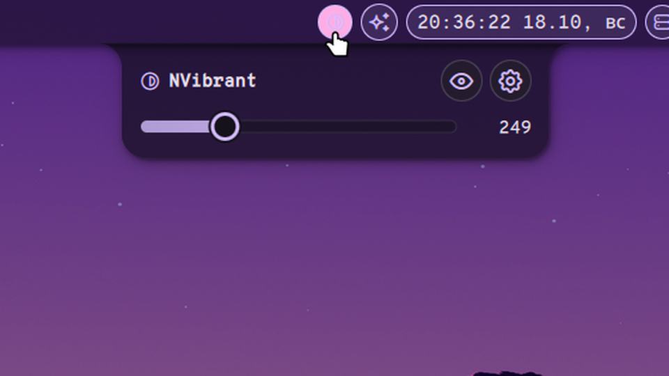

# NVibrant

A Noctalia plugin to toggle **NVIDIA digital vibrance** (color saturation) directly from the bar — no terminal needed.



## Features

- One-click toggle in the bar — icon highlights when vibrance is active
- Configurable vibrance level (0–1023)
- Multi-monitor support
- NVIDIA outputs via `nvibrant`; other outputs (e.g. a hybrid laptop's internal panel) via niri's `color-matrix` (needs a patched niri, see below)
- Tells you with a toast when there is nothing to apply to
- State persists across restarts
- Right-click context menu with quick enable/disable

## Requirements

- [nvibrant](https://github.com/Tremeschin/nvibrant) installed (`yay -S nvibrant-bin`) for displays connected to the NVIDIA GPU
- For displays driven by another GPU (typically the internal panel on a hybrid AMD/Intel + NVIDIA laptop), niri with the `color-matrix` output action — see [Internal panel on hybrid laptops](#internal-panel-on-hybrid-laptops-niri)

The plugin picks the backend per connected output automatically: outputs on the `nvidia` driver go through `nvibrant`, the rest through `niri msg output <name> color-matrix`. If neither can be used it shows a toast explaining why.

## Internal panel on hybrid laptops (niri)

`nvibrant` can only reach displays wired to the NVIDIA GPU. On hybrid laptops the internal panel (eDP) is usually driven by the iGPU, so the plugin sets saturation there with a hardware color matrix (DRM `CTM`) instead. Only the compositor (DRM master) can set that, and **niri does not support it in a release yet**. It is proposed upstream in [niri-wm/niri#4543](https://github.com/niri-wm/niri/pull/4543).

First check whether your niri already has it:

```bash
niri msg output --help | grep color-matrix
```

If that prints a line, you are done: enable the plugin and use it. If it prints nothing, pick one:

- **Wait** for a niri release that includes `color-matrix`. The plugin will start working on the panel with no changes.
- **Switch the BIOS to Discrete GPU / NVIDIA-only mode** (if your laptop has it). The panel then goes through NVIDIA and `nvibrant`; no niri changes needed.
- **Build niri with the PR (Arch Linux).** This is unofficial: you run unreleased code from a third-party fork, so read the [PR diff](https://github.com/niri-wm/niri/pull/4543/files) first. It replaces your `niri` package; undo it any time with `sudo pacman -S niri`.

  1. Needs `base-devel`, `git`, `clang`, `rust` and a few GB of free disk. Make an empty folder, save the file below as `PKGBUILD` in it, then run `makepkg -si` there (the build takes a few minutes; pacman will ask to remove `niri` because the new package replaces it).
  2. **Log out and back in.** A running niri keeps using the old binary until you do.
  3. Run `niri msg output --help | grep color-matrix` again; it should now print a line.

<details>
<summary>PKGBUILD</summary>

```bash
# niri built from PR niri-wm/niri#4543 (hardware color-matrix / DRM CTM).
# Drop this package and reinstall stock `niri` once the PR is merged and released.
pkgname=niri-ctm
_commit=e18cc4e2e5d810531a2ed15fad6df3bd50bcf528
pkgver=26.04.r204.ctm4543
pkgrel=1
pkgdesc="Scrollable-tiling Wayland compositor with DRM CTM color-matrix output option (PR #4543)"
arch=(x86_64)
url="https://github.com/niri-wm/niri/pull/4543"
license=(GPL-3.0-or-later)
depends=(cairo glib2 glibc libdisplay-info libgcc libinput libpipewire libxkbcommon mesa pango pixman seatd systemd-libs xdg-desktop-portal-impl)
makedepends=(clang git rust)
optdepends=(
  'alacritty: a suggested GPU-accelerated terminal emulator'
  'bash: for niri-session script'
  'xwayland-satellite: for running X11 apps in XWayland'
  'xdg-desktop-portal-gtk: a suggested XDG desktop portal'
  'xdg-desktop-portal-gnome: a XDG desktop portal required for screencasting'
)
provides=(niri wayland-compositor)
conflicts=(niri)
options=(!lto)
source=(niri-$_commit.tar.gz::https://github.com/nsrkn2n/niri/archive/$_commit.tar.gz)
sha256sums=(14512fe68d97c3a313b5567413b67ef64f6582e22ab339d82d37578346c1ab4a)

prepare() {
  cd niri-$_commit
  cargo fetch --locked --target "$(rustc --print host-tuple)"
}

build() {
  cd niri-$_commit
  export NIRI_BUILD_COMMIT="${_commit:0:7}"
  cargo build --frozen --release --features default
  for shell in bash fish zsh; do
    cargo run --frozen --release --bin niri -- completions "$shell" > "$shell-completions"
  done
}

package() {
  cd niri-$_commit
  install -vDm 755 {target/release/niri,resources/niri-session} -t "$pkgdir/usr/bin/"
  install -vDm 644 resources/niri{.service,-shutdown.target} -t "$pkgdir/usr/lib/systemd/user/"
  install -vDm 644 resources/niri.desktop -t "$pkgdir/usr/share/wayland-sessions/"
  install -vDm 644 resources/niri-portals.conf -t "$pkgdir/usr/share/xdg-desktop-portal/"
  install -vDm 644 resources/default-config.kdl README.md -t "$pkgdir/usr/share/doc/niri/"
  install -vDm 644 bash-completions "$pkgdir/usr/share/bash-completion/completions/niri"
  install -vDm 644 fish-completions "$pkgdir/usr/share/fish/vendor_completions.d/niri.fish"
  install -vDm 644 zsh-completions "$pkgdir/usr/share/zsh/site-functions/_niri"
}
```

</details>

How it behaves: the matrix is a standard saturation matrix (Rec. 709 luma weights) with `s = 1 + level/1023`. It is reset whenever niri restarts, so toggle the widget again after restarting niri. Non-Arch distributions: apply the PR commit `e18cc4e` from `nsrkn2n/niri` on top of niri and build as usual; the plugin only needs the `niri msg output <name> color-matrix` command to exist.

## Installation

Install via the Noctalia plugin manager, or manually:

```bash
git clone https://github.com/noctalia-dev/noctalia-plugins ~/.config/noctalia/plugins/nvibrant
```

*Note: If cloning manually, ensure the `nvibrant` folder is located directly inside your plugins directory.*

Then enable the plugin and add the bar widget in Noctalia Settings.

## Usage

| Action | Result |
|---|---|
| Left click | Toggle vibrance on/off |
| Right click | Context menu (toggle + settings) |
| IPC | `qs -c noctalia-shell ipc call plugin:nvibrant toggle` |

## Settings

| Setting | Default | Description |
|---|---|---|
| Vibrance Level | 512 | Intensity: 0 = default, 1023 = maximum saturation (~200%) |
| Display Port Index | 1 | Which `nvibrant` port to apply to (1 = first). Only used for NVIDIA displays; `nvibrant` prints the ports it sees when run without arguments |

## License

MIT
